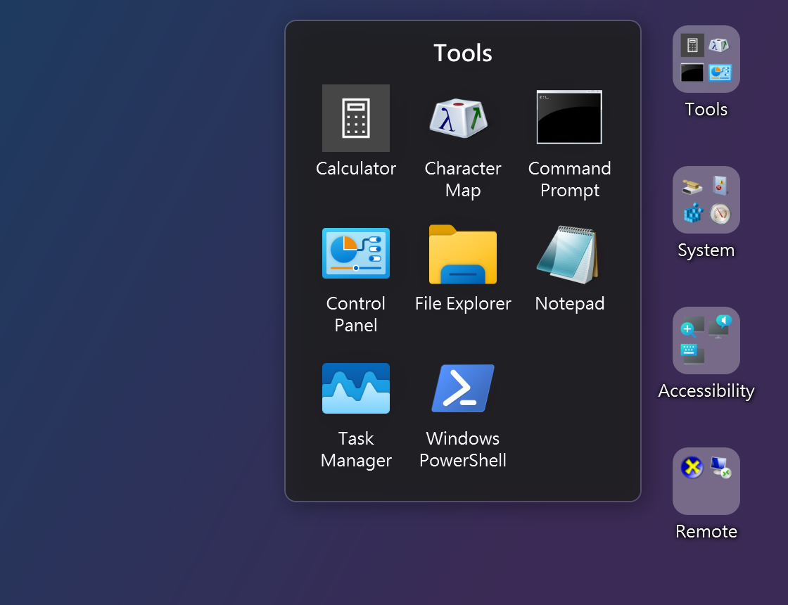
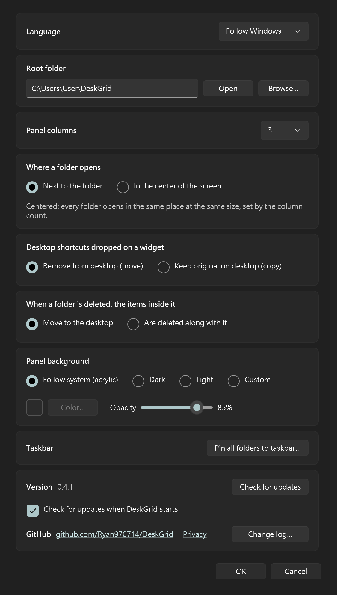

# DeskGrid

[繁體中文](README.zh-TW.md)

Phone-style folders on the Windows desktop. Each folder sits among your desktop icons as a small tile
showing a 2×2 preview of what's inside; click it to open a grid of its items and launch one.

Every folder is a real folder on disk, so whatever you change there shows up on the desktop right away.

- Lives in the desktop icon layer: behind every window, still there after Win+D, back on its own when
  Explorer restarts
- Drop one desktop icon on another and the two become a folder, like on a phone
- Drag shortcuts, programs, files or folders onto a folder to add them; rearrange the items inside a folder, or
  drag them out onto the desktop or into another folder
- Folders line up with the desktop's own icon grid and remember where you put them; icons that land on a folder
  step aside
- Right-click a folder to make a new one, delete it (to the Recycle Bin) or pin it to the taskbar
- Right-click an item in an open folder for the menu Explorer shows for it: Open, Send to, Cut, Copy, Delete,
  Properties and whatever your apps add
- Tray menu: new folder, settings, start with Windows, exit. Settings also has the taskbar button for all folders, a
  button that opens the root folder, the GitHub address and the change log
- Panel background: Windows 11 acrylic following the light/dark theme, dark, light, or your own color
- Folder names stay readable over a light wallpaper
- Checks GitHub for new versions and can update itself
- English and Traditional Chinese, following the Windows display language

## Screenshots

Folders on the desktop, one of them open (panel background "Dark"):



Settings:



The pictures are drawn by DeskGrid's own windows, filled with apps that come with Windows, on a plain background
instead of a desktop.

## Requirements

Windows 10 22H2 or Windows 11, 64-bit. No .NET install needed: the download is a single self-contained exe.

## Install

1. Download `DeskGrid-<version>-win-x64.exe` from [Releases](../../releases).
2. Put it wherever you like (e.g. `%LOCALAPPDATA%\Programs\DeskGrid\`) and run it.
3. The first time, DeskGrid asks whether it should start when you sign in to Windows. You can change that any time
   with **Start with Windows** in the tray menu. At sign-in DeskGrid waits for Explorer to lay out the desktop
   icons before it places the folders, so they line up with the icons and keep their positions.

### "Windows protected your PC"

The exe isn't code-signed (signing certificates cost money), so Microsoft Defender SmartScreen warns
about it until enough people have run it. To start it anyway, click **More info** → **Run anyway**.
If the file was blocked, right-click it → **Properties** → check **Unblock** → **OK**. Free signing through the
SignPath Foundation is planned; see [Code signing policy](#code-signing-policy).

### "An Application Control policy has blocked this file"

On Windows 11 with **Smart App Control** on (or a work PC with an App Control policy), Windows doesn't offer
"Run anyway" for a program that isn't signed and that nobody has vouched for yet. The exe isn't signed (see above), so
a downloaded copy can be refused with "An Application Control policy has blocked this file", often with
"dangerous extension from the internet". Nothing is wrong with the file. What helps, from least to most drastic:

1. Right-click the exe → **Properties** → **Unblock** → **OK**, then run it again. This removes the "came from the
   internet" mark; it is enough on some PCs.
2. Build it yourself ([below](#build-from-source)). A program you built on your own PC carries no such mark.
3. Turn Smart App Control off: **Settings** → **Privacy & security** → **Windows Security** → **App & browser
   control** → **Smart App Control settings** → **Off**. Windows may not let you turn it back on without reinstalling,
   so decide whether you want that.
4. On a PC that your organization manages, ask whoever runs it to allow the exe.

GitHub shows the SHA-256 of the exe on the release page, next to the file. To check that your download matches:

```powershell
Get-FileHash .\DeskGrid-0.3.5-win-x64.exe -Algorithm SHA256
```

If you'd rather not trust a binary, [build it yourself](#build-from-source).

## Usage

On first run DeskGrid creates `%USERPROFILE%\DeskGrid\`. **Every subfolder of it becomes a
desktop folder**; the files inside are its items.

| To | Do |
|---|---|
| Create a folder | Drag a desktop icon onto another one (see below), tray menu → **New folder…**, right-click a folder (or the name bar of an open folder) → **New folder…**, or create a subfolder in the root folder |
| Open a folder | Click it. Click an item to launch it. Esc, clicking elsewhere or clicking the folder again closes it |
| Open from the keyboard | **Ctrl+M** opens the list of all folders, whichever program you are in (press it again to close). A folder can have a shortcut of its own: see [Keyboard shortcuts](#keyboard-shortcuts) |
| Move a folder | Drag it; it snaps to the nearest free cell |
| Rename | Click the folder's name in its panel, or rename the subfolder in Explorer |
| Delete | Drag the folder onto the Recycle Bin icon on the desktop, or right-click the folder on the desktop, or the name bar of its open panel (or its entry in the all-folders list) → **Delete folder…**. The folder goes to the Recycle Bin; what happens to the items inside is up to Settings. There is no need to open the root folder |
| Open, delete, copy… an item | Right-click it in an open panel for Explorer's own menu (hold Shift for the extra commands). Rename is left out: rename the file in Explorer |
| Add items | Drag them onto the folder (see below), or put files into the subfolder |
| Reorder items | Drag an item to another place in the open panel; the others slide out of the way |
| Take items out | Drag an item out of the panel onto the desktop, or onto another folder (hold it over a folder for a moment to open it and drop inside) |
| Pin to the taskbar | Right-click a folder → **Pin to taskbar…**, then drag the shortcut that appears onto the taskbar (Windows only lets you do the pinning). **Settings** → **Taskbar** → **Pin all folders to taskbar…** pins one button that lists every folder |

### Making a folder from two icons

Drag a desktop shortcut or file onto another icon on the desktop and let go. A new folder, called "New folder", appears
where the icon you dropped on was, and holds both; click its name in its panel to rename it. Select several icons
first to bring them all along.

- It works on icons that are files on your desktop. "This PC", the Recycle Bin and other system icons can't be
  dropped on, and dropping onto a real folder on the desktop still moves the file into it, as usual.
- Dropping a file on a program's shortcut no longer opens the file with that program: it makes a folder instead.
- Shortcuts are moved or copied, and other files get a shortcut, by the same rules as dropping on a folder (below).

### Dropping onto a folder

| Dropped item | Result |
|---|---|
| Program (`.exe`) | A new shortcut to it. The program itself is never moved or copied |
| Shortcut (`.lnk`, `.url`) lying on the desktop | Moved into the folder (Settings can switch this to copy) |
| Shortcut from anywhere else (e.g. the Start menu folder) | Copied |
| Any other file, or a folder | A new shortcut to it; the original stays where it is |
| Item taken from another folder's panel | Moved |

Items keep the order they were added in; new items go last, or where you drop them in an open panel.

### Settings

Tray menu → **Settings…**:

- **Language**: English, Traditional Chinese (繁體中文), or follow Windows (the default). It applies as soon as you press Apply;
  the change log and the privacy link follow it.
- **Root folder**: where the folders live. It can't be on the desktop (its folders would show up twice). **Open** shows it in Explorer.
- **Panel columns** (1–8).
- **Where a folder opens**: next to its icon (the default), or in the middle of the screen. A centered folder always
  opens in the same place at the same size, whatever it holds: as wide as the column count, and as tall.
- **Desktop shortcuts dropped on a folder**: moved off the desktop, or copied.
- **When a folder is deleted, the items inside it**: moved to the desktop (the default), or deleted along with it.
  If an item can't be moved, the folder is kept.
- **Panel background**.
- **Taskbar**: **Pin all folders to taskbar…** makes the shortcut for one taskbar button that lists every folder; drag it
  onto the taskbar yourself (Windows only lets you do the pinning).
- **Check for updates**: looks for a newer release. If there is one you can update (downloads it, checks its SHA-256,
  and restarts into the new version), keep the current version (not asked about this release again), or cancel
  (asked again next start).
- **Check for updates when DeskGrid starts**: on by default; untick it and DeskGrid never contacts GitHub on its own
  (see [Privacy](#privacy)).
- **Keyboard shortcuts**: **Customize…** opens the list of shortcuts. See [Keyboard shortcuts](#keyboard-shortcuts).
- **Allow control from scripts and AI agents**: off by default. See [Scripts and AI agents](#scripts-and-ai-agents).
- **GitHub**: the address of the project. **Privacy** opens the [Privacy](#privacy) section of this README online.
  **Change log…** lists what changed in each version.

### Keyboard shortcuts

Shortcuts work from any program, not only when DeskGrid is in front. Settings → **Keyboard shortcuts** →
**Customize…** lists what can have one:

| Action | Default |
|---|---|
| Open all folders (the list a taskbar button would show; press again to close) | Ctrl+M |
| New folder… | none |
| Open settings | none |
| Open a folder (one line per folder) | none |

To set one, click its box and press the keys you want; Backspace (or the × button) clears it, and **Reset to defaults**
brings back the table above. A panel opens where the mouse pointer is, or in the middle of the screen if you chose
that under **Where a folder opens**. A folder keeps its shortcut when you rename it.

- A shortcut must include Ctrl, Alt or the Windows key, so it can't get in the way of typing. The key can be a letter,
  a digit, F1–F24, Space, Enter, an arrow or Home, End, PageUp, PageDown, Insert, Delete.
- Two actions can't share one shortcut, and Windows doesn't let two programs share one either. If another program
  already has the combination, DeskGrid tells you after you press OK; choose other keys.
- While DeskGrid runs, a shortcut belongs to it alone: other programs no longer get Ctrl+M (it is Enter in terminals and
  indent in many editors, for example). If that gets in the way, pick another combination here, such as Ctrl+Alt+M.

### Scripts and AI agents

With **Allow control from scripts and AI agents** ticked in Settings, a script or an AI agent (Claude Code, for
example) can drive the running DeskGrid from a command line:

```
DeskGrid.exe --ctl <command> [arguments]
```

| Command | What it does |
|---|---|
| `status` | Version, root folder, number of folders and the open panel. |
| `list [folder]` | All folders with their items in display order, or one folder. |
| `new <name>` | Creates a folder (a new folder on the desktop). |
| `rename <folder> <new name>` | Renames a folder. |
| `add <folder> <path>...` | Adds files, programs or folders, as dropping them on the folder would (programs get a shortcut). |
| `move <folder> <item> <index>` | Puts an item at a position (0 = first) in its folder. |
| `open [folder]` | Opens a folder's panel next to it, or the list of all folders. |
| `close` | Closes the open panel. |

Each command prints one line of JSON, `{"ok":true,"result":…}` or `{"ok":false,"error":"…"}`, with characters outside
ASCII written as `\uXXXX`, and exits with 0 (done), 1 (the command failed), 2 (DeskGrid is not running) or 3 (wrong
usage). Items are named by file name, as `list` shows them (`Notepad.lnk`). `DeskGrid.exe --ctl help` lists the
commands. Nothing can be deleted this way.

DeskGrid is a windowed program, so a command prompt doesn't wait for it: read its output through a pipe, e.g.
`DeskGrid.exe --ctl list | Out-String` in PowerShell. Under the hood it is a named pipe, `\\.\pipe\DeskGrid.Control.<user name>`,
taking one line of JSON per connection (`{"command":"list","args":["Work"]}`), which other programs can use directly.

### Files

| What | Where |
|---|---|
| Settings and folder positions | `%APPDATA%\DeskGrid\config.json` |
| Log | `%LOCALAPPDATA%\DeskGrid\deskgrid.log` |
| Your folders | `%USERPROFILE%\DeskGrid\` (or the root folder you chose) |

### Uninstall

Turn off **Start with Windows**, exit from the tray menu and delete the exe. To remove settings too,
delete `%APPDATA%\DeskGrid` and `%LOCALAPPDATA%\DeskGrid`. Your folders and their contents are
never touched.

## Privacy

DeskGrid collects nothing: no telemetry, no analytics, no account. Everything it stores (settings, folder positions,
the log) stays on your PC, in the files listed under [Files](#files).

It uses the network for one thing, looking for a newer version on GitHub:

- A few seconds after it starts, and whenever you press **Check for updates** in Settings, it asks `api.github.com`
  for the latest release of this project. GitHub sees what any web request shows (your IP address and a
  `DeskGrid/<version>` user agent); DeskGrid sends nothing else.
- If you choose **Update**, it downloads the new exe from GitHub and checks its SHA-256 before replacing the old one.
- Untick **Check for updates when DeskGrid starts** in Settings and DeskGrid makes no network connection unless you
  press **Check for updates**.

**Start with Windows** is only set up if you say yes (on first run, or from the tray menu). It adds a single entry
under `HKCU\Software\Microsoft\Windows\CurrentVersion\Run`, and turning it off removes it. See [Uninstall](#uninstall)
for removing everything else.

**Allow control from scripts and AI agents** (off by default) only listens on a named pipe on this PC, which only
programs running under your own Windows account can open; it uses no network.

## Code signing policy

Releases are not code-signed yet (see [Windows protected your PC](#windows-protected-your-pc)). DeskGrid aims to get
free code signing from the [SignPath Foundation](https://signpath.org/). Once that is in place, the release exe is
signed and this notice applies:

> Free code signing provided by [SignPath.io](https://signpath.io/), certificate by
> [SignPath Foundation](https://signpath.org/).

- **What is signed**: only `DeskGrid-<version>-win-x64.exe`, built from the source in this repository by the
  [Release workflow](.github/workflows/release.yml) when a version tag is pushed. Nothing built elsewhere is signed,
  and no upstream binaries are modified.
- **Roles**: Ryan Kuo ([@Ryan970714](https://github.com/Ryan970714)), the sole maintainer, is author, reviewer and
  approver. Changes from other contributors are reviewed by the maintainer before they are merged, and the maintainer
  approves every signing request by hand.
- **Privacy**: see [Privacy](#privacy) above.

## Known limitations

- Dropping one icon on another only makes a folder for drags that start on the desktop itself.
- With "Auto arrange icons" on, Explorer keeps the icons where it wants them, so a folder moves out of the way of
  an icon instead of the other way round.
- A panel opened from a taskbar button appears at the mouse pointer, so it can come up in the wrong place if you move
  the mouse right after clicking.
- Changing resolution, scaling or the taskbar while running doesn't re-snap folders until a restart.
- Multiple monitors with different scaling aren't supported yet.
- Apps dragged from the Start menu (no file behind them) can't be added.
- When DeskGrid runs as administrator, Windows blocks drops from Explorer.
- The tray menu stays light in dark mode.
- An item's right-click menu is the classic Windows menu (what Windows 11 shows under "Show more options"), not the
  compact Windows 11 one.
- Only tested on Windows 11; the Windows 10 desktop layout is handled but not yet verified.

## Build from source

Requires the [.NET 10 SDK](https://dotnet.microsoft.com/download).

```powershell
dotnet build DeskGrid.slnx
dotnet test DeskGrid.slnx
dotnet publish src/DeskGrid/DeskGrid.csproj -p:PublishProfile=win-x64   # -> artifacts/publish/DeskGrid.exe
```

Pushing a tag such as `v0.1.0` makes GitHub Actions publish a release.

### How it works

Each folder is a small per-pixel transparent WPF window parented to Explorer's `SHELLDLL_DefView`, the
window that holds the desktop icons, placed above the icon list. That is what keeps it behind other
windows yet clickable, and it works with both the classic desktop layout and the one in Windows 11
24H2. When Explorer restarts and takes those windows with it, DeskGrid re-attaches them.
`CLAUDE.md` and `context/` hold the design notes and decisions. DeskGrid is bilingual: every document comes in English
(`NAME.md`) and Traditional Chinese (`NAME.zh-TW.md`) and every text in the app in both languages; the rules for
contributors are in "Language policy" in `AGENTS.md`.

## Third-party notices

The **Liquid glass** panel background (`src/DeskGrid/Glass/`) draws a rounded sheet that blurs and bends the screen
behind it. Its refraction curve and rim glow are adapted from [OverShifted/LiquidGlass](https://github.com/OverShifted/LiquidGlass)
(an OpenGL shader), and the idea of bending a backdrop with a rounded-rectangle distance field, with a slight contrast
and saturation lift, comes from [shuding/liquid-glass](https://github.com/shuding/liquid-glass) (an SVG filter). Both
are MIT-licensed and were re-written for the CPU in C#. Their notice and license follow, as the licenses ask:

> Copyright (c) 2026 Sepehr Kalanaki (OverShifted/LiquidGlass)
> Copyright (c) 2025 Shu Ding (shuding/liquid-glass)
>
> Permission is hereby granted, free of charge, to any person obtaining a copy of this software and associated
> documentation files (the "Software"), to deal in the Software without restriction, including without limitation the
> rights to use, copy, modify, merge, publish, distribute, sublicense, and/or sell copies of the Software, and to
> permit persons to whom the Software is furnished to do so, subject to the following conditions:
>
> The above copyright notice and this permission notice shall be included in all copies or substantial portions of the
> Software.
>
> THE SOFTWARE IS PROVIDED "AS IS", WITHOUT WARRANTY OF ANY KIND, EXPRESS OR IMPLIED, INCLUDING BUT NOT LIMITED TO THE
> WARRANTIES OF MERCHANTABILITY, FITNESS FOR A PARTICULAR PURPOSE AND NONINFRINGEMENT. IN NO EVENT SHALL THE AUTHORS OR
> COPYRIGHT HOLDERS BE LIABLE FOR ANY CLAIM, DAMAGES OR OTHER LIABILITY, WHETHER IN AN ACTION OF CONTRACT, TORT OR
> OTHERWISE, ARISING FROM, OUT OF OR IN CONNECTION WITH THE SOFTWARE OR THE USE OR OTHER DEALINGS IN THE SOFTWARE.

"Liquid Glass" is a name used by Apple Inc. DeskGrid's glass is an approximation of the look, not Apple's code, and is
not affiliated with or endorsed by Apple.

## License

[MIT](LICENSE) © 2026 Ryan Kuo
