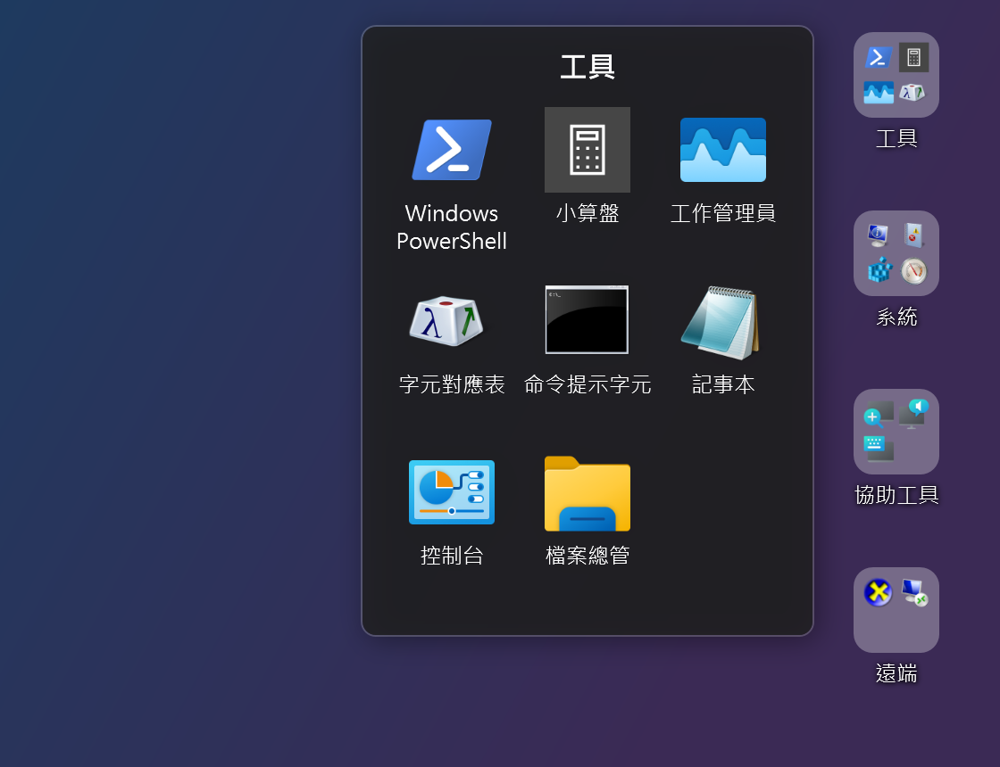
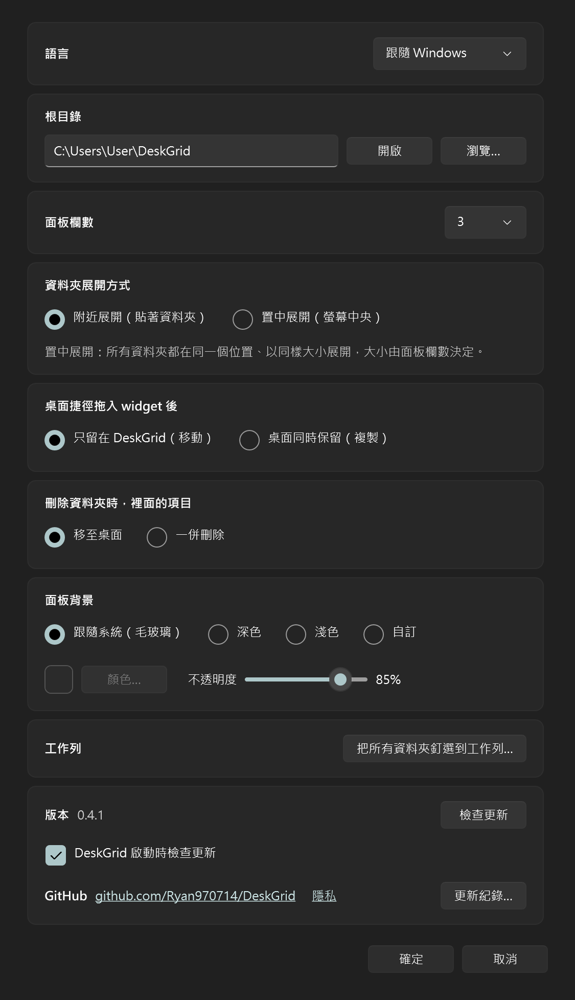

# DeskGrid

[English](README.md)

把手機式資料夾放到 Windows 桌面上。每個資料夾以小方塊的樣子排在桌面圖示之間，顯示裡面項目的
2×2 預覽；點一下就展開成格子面板，再點項目即可啟動。

每個資料夾都對應磁碟上一個真實的資料夾，在那裡做的任何變更都會立刻反映到桌面上。

- 位於桌面圖示層：在所有視窗後方、按 Win+D 後仍在、檔案總管重新啟動後會自動回來
- 像手機一樣，把一個桌面圖示放到另一個上面，兩個就變成一個資料夾
- 把捷徑、程式、檔案或資料夾拖到資料夾上即可加入；資料夾裡的項目可以重新排序，也能拖出到桌面或別的資料夾
- 資料夾對齊桌面原生圖示的格線並記住位置；落到資料夾上的圖示會自動讓開
- 在資料夾上按右鍵可以新增資料夾、刪除（進資源回收筒）或釘選到工作列
- 在已開啟的資料夾裡對項目按右鍵，會出現檔案總管對它顯示的那個選單：開啟、傳送到、剪下、複製、刪除、內容，
  以及你安裝的程式加進去的項目
- 系統匣選單：新增資料夾、設定、開機時啟動、結束。設定裡還有「所有資料夾」的工作列按鈕、開啟根目錄的按鈕、
  GitHub 網址與更新紀錄
- 面板背景：Windows 11 毛玻璃（跟隨系統深淺色）、深色、淺色，或自訂顏色
- 淺色桌布上資料夾名稱仍然看得清楚
- 會檢查 GitHub 上的新版本，並可自行更新
- 介面支援英文與繁體中文，依 Windows 顯示語言自動切換

## 螢幕截圖

桌面上的資料夾，其中一個已開啟（面板背景「深色」）：



設定：



這些圖由 DeskGrid 自己的視窗繪製，內容是 Windows 內建的 App，背景用純色代替桌面。

## 系統需求

Windows 10 22H2 或 Windows 11，64 位元。不需安裝 .NET：下載的是自帶執行環境的單一 exe。

## 安裝

1. 到 [Releases](../../releases) 下載 `DeskGrid-<版本>-win-x64.exe`。
2. 放到任意位置（例如 `%LOCALAPPDATA%\Programs\DeskGrid\`）後執行。
3. 第一次執行時，DeskGrid 會問你要不要在登入 Windows 時自動啟動；之後隨時可以用系統匣選單的
   **開機時啟動** 更改。開機啟動時 DeskGrid 會等檔案總管排好桌面圖示再放資料夾，所以資料夾會對齊圖示、
   位置也不會跑掉。

### 「Windows 已保護您的電腦」

這個 exe 沒有程式碼簽章（簽章憑證需要付費），所以在足夠多人執行過之前，Microsoft Defender
SmartScreen 會跳出警告。要繼續執行，請按 **其他資訊** → **仍要執行**。
若檔案被封鎖，請在檔案上按右鍵 → **內容** → 勾選 **解除封鎖** → **確定**。我們打算透過 SignPath Foundation
取得免費的程式碼簽章，見[程式碼簽章政策](#程式碼簽章政策)。

### 「應用程式控制原則已封鎖此檔案」

在開啟 **智慧型應用程式控制**（Smart App Control）的 Windows 11，或套用了應用程式控制原則的公司電腦上，
沒有簽章、又還沒有人背書的程式，Windows 不會給「仍要執行」的選項。這個 exe 沒有簽章（見上方），所以下載來的
檔案可能被擋下，顯示「應用程式控制原則已封鎖此檔案」，常常還附上「來自網路的危險副檔名」。檔案本身沒有問題。
由輕到重的解法：

1. 在 exe 上按右鍵 → **內容** → 勾選 **解除封鎖** → **確定**，再執行一次。這會移除「來自網路」的標記，
   有些電腦這樣就夠了。
2. 自己建置（[見下方](#從原始碼建置)）。自己電腦上建出來的程式沒有這個標記。
3. 關閉智慧型應用程式控制：**設定** → **隱私權與安全性** → **Windows 安全性** → **應用程式與瀏覽器控制** →
   **智慧型應用程式控制設定** → **關閉**。關閉後 Windows 可能不讓你再開回來，除非重灌，請自行斟酌。
4. 由機構管理的電腦，請管理者放行這個 exe。

GitHub 的 Release 頁面會在檔案旁顯示 exe 的 SHA-256。檢查下載的檔案是否一致：

```powershell
Get-FileHash .\DeskGrid-0.3.5-win-x64.exe -Algorithm SHA256
```

如果不想信任現成的執行檔，也可以[自己從原始碼建置](#從原始碼建置)。

## 使用方式

第一次執行時會建立 `%USERPROFILE%\DeskGrid\`。**其中每個子資料夾都會成為桌面上的一個資料夾**，
裡面的檔案就是它的項目。

| 想要 | 做法 |
|---|---|
| 建立資料夾 | 把一個桌面圖示拖到另一個桌面圖示上（見下方）、系統匣選單 → **新增資料夾…**、在資料夾（或已開啟資料夾的名稱列）上按右鍵 → **新增資料夾…**，或直接在根目錄建立子資料夾 |
| 開啟資料夾 | 點它，再點項目即可啟動。按 Esc、點其他地方或再點一次資料夾就會收合 |
| 用鍵盤開啟 | 在任何程式中按 **Ctrl+M** 會開啟所有資料夾的列表（再按一次收合）。每個資料夾也能有自己的快速鍵：見[鍵盤快速鍵](#鍵盤快速鍵) |
| 移動資料夾 | 拖曳它，放開後會對齊到最近的空格 |
| 重新命名 | 在面板裡點資料夾名稱，或在檔案總管裡重新命名該子資料夾 |
| 刪除 | 把資料夾拖到桌面的資源回收筒圖示上，或在桌面上的資料夾、已開啟面板的名稱列（或「所有資料夾」列表裡的那一格）按右鍵 → **刪除資料夾…**。資料夾會進資源回收筒，裡面的項目如何處理由設定決定。不必再進根目錄 |
| 對項目開啟、刪除、複製… | 在已開啟的面板裡對項目按右鍵，會出現檔案總管自己的選單（按住 Shift 會多出更多指令）。沒有「重新命名」：請在檔案總管裡改檔名 |
| 加入項目 | 拖到資料夾上（見下表），或直接把檔案放進子資料夾 |
| 重新排序項目 | 在開啟的面板裡把項目拖到別的位置，其他項目會滑開讓位 |
| 取出項目 | 把項目從面板拖出，放到桌面或另一個資料夾上（拖在資料夾上停一下會自動開啟它，再放進去） |
| 釘選到工作列 | 在資料夾上按右鍵 → **釘選到工作列…**，再把出現的捷徑拖到工作列上（Windows 只允許使用者自己釘選）。**設定** → **工作列** → **把所有資料夾釘選到工作列…** 會釘一個列出所有資料夾的按鈕 |

### 用兩個圖示做出資料夾

把桌面上的一個捷徑或檔案拖到另一個桌面圖示上再放開。被放上的那個圖示原本的位置會出現一個名為
「New folder」（中文介面為「新資料夾」）的資料夾，裡面有這兩個項目；之後在面板裡點名稱即可改名。先選取多個圖示再拖，
就能一次全部帶進去。

- 只對桌面上的檔案圖示有效。「本機」、資源回收筒等系統圖示不能當放置目標；放到桌面上的真資料夾仍然是
  照常把檔案移進去。
- 把檔案拖到某個程式的捷徑上，不會再用那個程式開啟它，而是做出資料夾。
- 圖示會移進新資料夾，規則與拖到資料夾上相同（見下表）。

### 拖到資料夾上

| 拖入的項目 | 結果 |
|---|---|
| 放在桌面上的任何東西：捷徑、檔案、程式或資料夾 | 移進資料夾，桌面不再有它。設定選 **桌面保留** 時桌面不動：捷徑用複製，其他建立捷徑 |
| 其他地方的捷徑（`.lnk`、`.url`，例如開始功能表資料夾） | 複製 |
| 其他地方的檔案、程式（`.exe`）或資料夾 | 建立指向它的捷徑，原件留在原處，絕不移動或複製 |
| 從別的資料夾面板拖出的項目 | 移動 |

項目依加入的先後排序，新項目排在最後；若是放進已開啟的面板，則放在你放開的位置。

### 設定

系統匣選單 → **設定…**：

- **語言**：English、繁體中文，或跟隨 Windows（預設）。按「套用」後立即套用；更新紀錄與隱私連結也跟著切換。
- **根目錄**：資料夾存放的位置。不能放在桌面上（否則其中的資料夾會重複出現）。**開啟** 會在檔案總管裡顯示它。
- 面板的 **欄數**（1–8）。
- **資料夾展開位置**：資料夾旁（預設），或螢幕正中央。置中展開時，無論資料夾裡有多少東西，每個資料夾都開在同一個位置、
  同樣大小：寬度是欄數，高度也是欄數。
- **從桌面拖入的項目**：**移入資料夾**（預設，桌面不再有它）或 **桌面保留**（捷徑用複製，其他建立捷徑）。
- **刪除資料夾時，裡面的項目**：移到桌面（預設），或一併刪除。只要有項目移不過去，資料夾就不會被刪。
- 面板的 **背景**。
- **工作列**：**釘選所有資料夾…** 會做出一個捷徑，對應一顆列出所有資料夾的工作列按鈕；請自己把它拖到工作列上
  （Windows 只允許使用者自己釘選）。
- **檢查更新**：查看有沒有新版本。有新版本時可選擇「更新」（下載、驗證 SHA-256，並以新版本重新啟動）、
  「維持」（不再提醒這個版本）或「取消」（下次啟動再提醒）。
- **啟動時檢查**：預設開啟；取消勾選後，DeskGrid 不會自己連到 GitHub（見[隱私](#隱私)）。
- **鍵盤快速鍵**：**自訂…** 會開啟快速鍵列表。見[鍵盤快速鍵](#鍵盤快速鍵)。
- **允許腳本與 AI agent 控制**：預設關閉。見[腳本與 AI agent](#腳本與-ai-agent)。
- **GitHub**：專案網址。**隱私** 會在網路上開啟本 README 的[隱私](#隱私)段落。**更新紀錄…** 列出每個版本改了什麼。

### 鍵盤快速鍵

快速鍵在任何程式中都有效，不必讓 DeskGrid 在最前面。「設定」→ **鍵盤快速鍵** → **自訂…** 會列出能設快速鍵的動作：

| 動作 | 預設 |
|---|---|
| 開啟所有資料夾（和工作列按鈕顯示的列表一樣；再按一次收合） | Ctrl+M |
| 新增資料夾… | 無 |
| 開啟設定 | 無 |
| 開啟某個資料夾（每個資料夾一列） | 無 |

要設定時，點一下它的欄位再按下想要的組合鍵；按 Backspace（或 × 按鈕）清除，**還原預設值** 會回到上表。面板會開在滑鼠游標
所在的位置；如果你在 **資料夾展開位置** 選了螢幕中央，則開在螢幕正中央。資料夾重新命名後仍保有它的快速鍵。

- 快速鍵必須包含 Ctrl、Alt 或 Windows 鍵，才不會干擾一般打字。主鍵可以是字母、數字、F1–F24、空白鍵、Enter、方向鍵，
  或 Home、End、PageUp、PageDown、Insert、Delete。
- 兩個動作不能共用同一組快速鍵，Windows 也不允許兩個程式共用。如果別的程式已經用了這組按鍵，按「確定」後 DeskGrid 會告訴你，
  請換一組。
- DeskGrid 執行期間，快速鍵只屬於它：其他程式就收不到 Ctrl+M 了（例如它在終端機裡是 Enter，在許多編輯器裡是縮排）。
  如果造成妨礙，請在這裡換一組，例如 Ctrl+Alt+M。

### 腳本與 AI agent

在設定裡勾選 **允許腳本與 AI agent 控制** 後，腳本或 AI agent（例如 Claude Code）就能從命令列操作執行中的 DeskGrid：

```
DeskGrid.exe --ctl <指令> [參數]
```

| 指令 | 作用 |
|---|---|
| `status` | 版本、根資料夾、資料夾數量，以及目前開啟的面板。 |
| `list [資料夾]` | 所有資料夾與其中的項目（依顯示順序），或只列一個資料夾。 |
| `new <名稱>` | 建立資料夾（桌面上多一個資料夾）。 |
| `rename <資料夾> <新名稱>` | 重新命名資料夾。 |
| `add <資料夾> <路徑>...` | 加入檔案、程式或資料夾，效果和拖到資料夾上一樣（程式會建立捷徑）。 |
| `move <資料夾> <項目> <位置>` | 把項目移到資料夾中的某個位置（0 = 第一個）。 |
| `open [資料夾]` | 在資料夾旁開啟它的面板，或開啟所有資料夾的清單。 |
| `close` | 關閉開啟中的面板。 |
| `island show <文字> [秒數] [--icon 名稱] [--color #RRGGBB] [--progress 0-100] [--open 目標]` | 在 NotiLand 上顯示一行字幾秒鐘（預設 5 秒，最多 60 秒），可加符號、顏色、進度條，以及點一下要開啟的目標（`folder:名稱`、http(s) 網址或已存在的路徑）。要先開啟 NotiLand。 |
| `island hide` | 收起 NotiLand 正在顯示的內容。 |
| `island timer` / `island card` / `island info` | 開始或停止 NotiLand 計時器；開啟或關閉卡片；顯示資訊（用量、系統、播放器）。 |
| `island place <情境>` | 設定 NotiLand 在該情境（`default`、`desktop`、`window`、`maximized` 或 `fullScreen`）的位置：所有視窗縮小，拖動它（會吸附），Enter 儲存，Esc 取消。 |

每個指令會印出一行 JSON：`{"ok":true,"result":…}` 或 `{"ok":false,"error":"…"}`，ASCII 以外的字元寫成
`\uXXXX`；結束代碼為 0（完成）、1（指令失敗）、2（DeskGrid 沒有在執行）或 3（用法錯誤）。項目以檔名指定，與 `list`
顯示的相同（`Notepad.lnk`）。`DeskGrid.exe --ctl help` 會列出所有指令。這個方式無法刪除任何東西。

DeskGrid 是視窗程式，命令提示字元不會等它結束，所以請透過管線讀取輸出，例如 PowerShell 的
`DeskGrid.exe --ctl list | Out-String`。底層是一條 named pipe：`\\.\pipe\DeskGrid.Control.<使用者名稱>`，每次連線送一行
JSON（`{"command":"list","args":["Work"]}`），其他程式也可以直接使用。

### NotiLand

NotiLand（DeskGrid 的「提示島」，正式名稱）是一顆黑色小膠囊，預設在主螢幕頂端正中央，也可以拖到別處，用來顯示簡短訊息。在 設定 → NotiLand 勾選 **顯示 NotiLand**（預設關閉）後，腳本或 AI agent 就能用
`DeskGrid.exe --ctl island show "建置完成" 10` 在上面放一行字（同時需要勾選 **允許腳本與 AI agent 控制**）。

- 一行字預設停 5 秒，也可以指定別的秒數（最多 60 秒）；多則訊息會排隊輪流顯示。
- 游標指上去它會展開顯示完整文字並等你讀完；點一下就關掉。
- 它不會搶走鍵盤焦點，全螢幕遊戲、影片或簡報執行時會自動隱藏。
- 顯示訊息時它會蓋住螢幕頂端正中央底下的東西。它不讀取任何資料、也不連網：訊息只來自 `--ctl`。

### 檔案位置

| 內容 | 位置 |
|---|---|
| 設定與資料夾位置 | `%APPDATA%\DeskGrid\config.json` |
| Log | `%LOCALAPPDATA%\DeskGrid\deskgrid.log` |
| 你的資料夾 | `%USERPROFILE%\DeskGrid\`（或你選擇的根目錄） |

### 解除安裝

關閉 **開機時啟動**、從系統匣選單結束，然後刪除 exe。若也要移除設定，再刪除
`%APPDATA%\DeskGrid` 與 `%LOCALAPPDATA%\DeskGrid`。你的資料夾與其中的檔案不會被動到。

## 隱私

DeskGrid 不蒐集任何資料：沒有遙測、沒有分析、不需要帳號。它存的東西（設定、資料夾位置、log）都留在你的電腦上，
位置見[檔案位置](#檔案位置)。

預設它只為了一件事使用網路：到 GitHub 查有沒有新版本。

- 啟動幾秒後，以及你在設定裡按 **檢查更新** 時，會向 `api.github.com` 查詢本專案最新的 Release。GitHub 看得到任何
  網路請求都會帶的資訊（你的 IP 位址與 `DeskGrid/<版本>` 的 User-Agent），DeskGrid 不會多送其他東西。
- 若你選擇 **更新**，才會從 GitHub 下載新的 exe，並在取代舊檔前驗證 SHA-256。
- 在設定裡取消勾選 **啟動時檢查** 後，除非你按 **檢查更新**，DeskGrid 不會建立任何網路連線。

**開機時啟動** 只有在你同意時才會設定（第一次執行時，或從系統匣選單）。它只會在
`HKCU\Software\Microsoft\Windows\CurrentVersion\Run` 加一筆項目，關閉就移除。其餘的移除方式見[解除安裝](#解除安裝)。

**允許腳本與 AI agent 控制**（預設關閉）只會在這台電腦上監聽一條 named pipe，而且只有以你自己的 Windows 帳戶執行的程式能開啟；
不使用網路。

**向 Anthropic 讀取方案用量**（NotiLand 的 AI 用量；預設關閉）是唯一另一個使用網路的地方。開啟後，DeskGrid 會讀取
Claude Code 存在 `~/.claude/.credentials.json` 的存取 token，每隔幾分鐘把它送到 `api.anthropic.com`
（`/api/oauth/usage`），取得你方案的 5 小時與每週用量，也就是 Claude 自己的用量頁面顯示的數字。token 只用在這個請求：
不儲存、不寫入 log、不送到別處，也不會送出任何檔案或工作階段的內容。token 過期時 DeskGrid 不會幫你更新（Claude Code 執行時會做）。
這個端點沒有公開文件，可能改變；失敗時用量會回到依記錄的估算（以 `≈` 表示）。

## 程式碼簽章政策

目前的 Release 尚未簽章（見上方「Windows 已保護您的電腦」）。DeskGrid 打算取得
[SignPath Foundation](https://signpath.org/) 提供的免費程式碼簽章。取得之後，發布的 exe 會被簽章，並適用以下聲明：

> Free code signing provided by [SignPath.io](https://signpath.io/), certificate by
> [SignPath Foundation](https://signpath.org/).

- **簽章對象**：只有 `DeskGrid-<版本>-win-x64.exe`，由 [Release workflow](.github/workflows/release.yml) 在推送版本 tag
  時，從本 repo 的原始碼建置。在其他地方建置的檔案一律不簽，也不會修改任何上游的二進位檔。
- **角色**：作者、審查者與核准者都是唯一的維護者 Ryan Kuo（[@Ryan970714](https://github.com/Ryan970714)）。
  其他貢獻者的變更會先由維護者審查才合併，每一次簽章請求也由維護者親自核准。
- **隱私**：見上方[隱私](#隱私)。

## 已知限制

- 把一個圖示放到另一個上面做出資料夾，只適用於從桌面本身開始拖的圖示。
- 桌面開啟「自動排列圖示」時，檔案總管會自己決定圖示位置，所以圖示被放到資料夾上時，是資料夾讓開而不是圖示。
- 從工作列按鈕開啟的面板會出現在滑鼠游標處，點完立刻移開滑鼠時，面板可能出現在別的地方。
- 執行中變更解析度、縮放比例或工作列時，資料夾要重新啟動後才會重新對齊。
- 尚未支援縮放比例不同的多螢幕。
- 無法加入從開始功能表拖來的 App（背後沒有檔案）。
- 以系統管理員身分執行時，Windows 會擋掉從檔案總管拖來的檔案。
- 深色模式下系統匣選單仍是淺色。
- 項目的右鍵選單是傳統的 Windows 選單（Windows 11 的「顯示其他選項」裡的那個），不是 Windows 11 的精簡選單。
- 目前只在 Windows 11 上測試過；Windows 10 的桌面結構有處理，但尚未實機驗證。

## 從原始碼建置

需要 [.NET 10 SDK](https://dotnet.microsoft.com/download)。

```powershell
dotnet build DeskGrid.slnx
dotnet test DeskGrid.slnx
dotnet publish src/DeskGrid/DeskGrid.csproj -p:PublishProfile=win-x64   # -> artifacts/publish/DeskGrid.exe
```

推送 `v0.1.0` 這類 tag 時，GitHub Actions 會自動發布 Release。

### 運作原理

每個資料夾都是一個逐像素透明的小型 WPF 視窗，掛在檔案總管放桌面圖示的 `SHELLDLL_DefView` 底下、
圖示清單的上方。這讓它位於其他視窗後方卻仍可點擊，而且同時適用傳統桌面結構與 Windows 11 24H2
的新結構。檔案總管重新啟動時會連同這些視窗一起銷毀，DeskGrid 會自動重新掛上。
設計筆記與決策紀錄在 `CLAUDE.md` 與 `context/`。DeskGrid 是雙語專案：每份文件都有英文（`NAME.md`）與繁體中文
（`NAME.zh-TW.md`）兩個版本，App 裡的每段文字也都有兩種語言；貢獻者要遵守的規則在 `AGENTS.md` 的「語言政策」。

## 第三方聲明

**液態玻璃** 面板背景（`src/DeskGrid/Glass/`）會畫出一片圓角玻璃，把後面的畫面模糊並彎折。折射曲線與邊緣光暈改寫自
[OverShifted/LiquidGlass](https://github.com/OverShifted/LiquidGlass)（OpenGL shader），用圓角矩形距離場彎折背景、
再稍微提高對比與飽和度的做法，則來自 [shuding/liquid-glass](https://github.com/shuding/liquid-glass)（SVG 濾鏡）。
兩者都是 MIT 授權，DeskGrid 以 C# 在 CPU 上重寫。依授權要求，附上它們的著作權聲明與授權條文（法律文字維持英文）：

> Copyright (c) 2026 Sepehr Kalanaki (OverShifted/LiquidGlass)
> Copyright (c) 2025 Shu Ding (shuding/liquid-glass)
> Copyright (c) 2025 ryoppippi (ryoppippi/ccusage)
>
> Permission is hereby granted, free of charge, to any person obtaining a copy of this software and associated
> documentation files (the "Software"), to deal in the Software without restriction, including without limitation the
> rights to use, copy, modify, merge, publish, distribute, sublicense, and/or sell copies of the Software, and to
> permit persons to whom the Software is furnished to do so, subject to the following conditions:
>
> The above copyright notice and this permission notice shall be included in all copies or substantial portions of the
> Software.
>
> THE SOFTWARE IS PROVIDED "AS IS", WITHOUT WARRANTY OF ANY KIND, EXPRESS OR IMPLIED, INCLUDING BUT NOT LIMITED TO THE
> WARRANTIES OF MERCHANTABILITY, FITNESS FOR A PARTICULAR PURPOSE AND NONINFRINGEMENT. IN NO EVENT SHALL THE AUTHORS OR
> COPYRIGHT HOLDERS BE LIABLE FOR ANY CLAIM, DAMAGES OR OTHER LIABILITY, WHETHER IN AN ACTION OF CONTRACT, TORT OR
> OTHERWISE, ARISING FROM, OUT OF OR IN CONNECTION WITH THE SOFTWARE OR THE USE OR OTHER DEALINGS IN THE SOFTWARE.

NotiLand 的 **AI 用量**（`src/DeskGrid/Island/UsageMonitor.cs`）依
[ryoppippi/ccusage](https://github.com/ryoppippi/ccusage) 的方式讀取 Claude Code 的記錄：要找的資料夾（`CLAUDE_CONFIG_DIR`、
`~/.config/claude`、`~/.claude`）、每個回應只算一次（子代理重播的也一樣）、輸入、輸出與快取建立的 token（不算快取讀取：它遠大於其他部分），以及 Claude 的 5 小時工作階段區塊。
這段邏輯由 ccusage 的 Rust 原始碼（MIT）改寫為 C#，其著作權聲明列在上方，授權條文相同。

NotiLand 在 Windows 上的提示島概念與互動設計靈感啟發自
[MoFeng2223/BrimDeck](https://github.com/MoFeng2223/BrimDeck)。NotiLand 雖然是為 DeskGrid 從零原生撰寫、未包含 BrimDeck 的程式碼，但我們由衷感謝該專案將提示島體驗帶入 Windows 桌面的先導性探索。

「Liquid Glass」是 Apple Inc. 使用的名稱。DeskGrid 的玻璃只是模仿那種外觀，不是 Apple 的程式碼，也與 Apple 無關、
未獲其認可。

## 授權

[MIT](LICENSE) © 2026 Ryan Kuo
